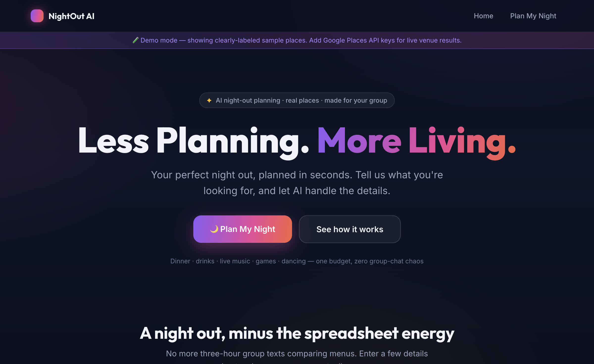
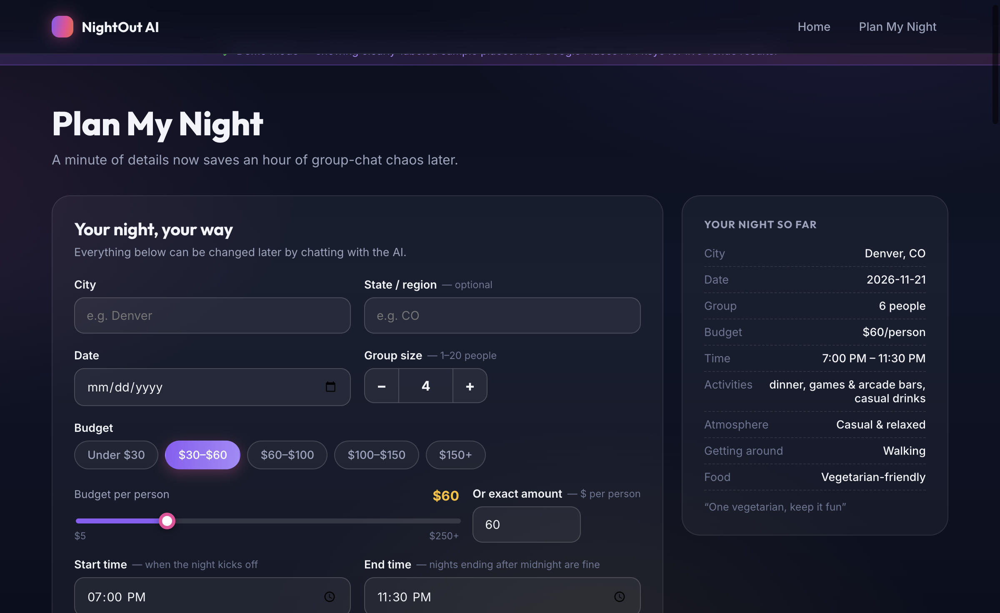
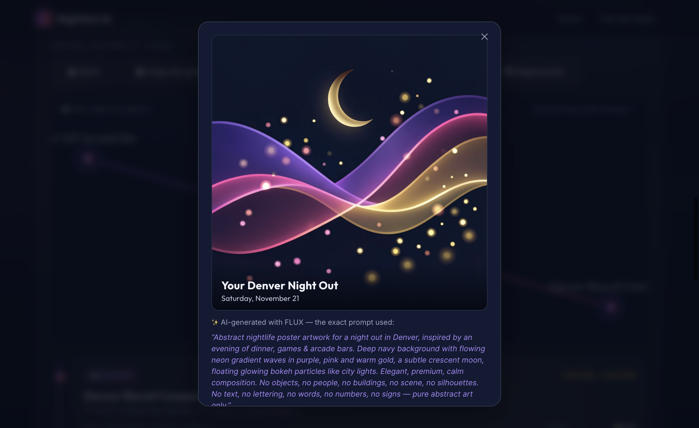
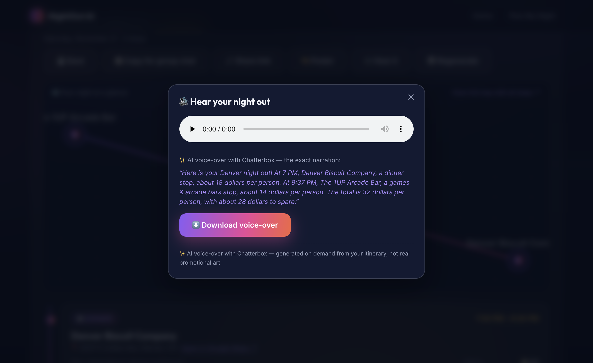

# 🌙 NightOut AI

> **Less Planning. More Living.**

**GitHub:** https://github.com/Marandacsmith96/nightout-ai
&nbsp;·&nbsp; **Open the app (when running):** http://localhost:5173

[](https://github.com/Marandacsmith96/nightout-ai/actions/workflows/ci.yml)

NightOut AI is a smart group night-out planner. Tell it your city, budget, group
size, free time, and what you're into — it returns a complete evening itinerary
with real places, real addresses, per-person costs, travel times, and a map.
Then keep tweaking it by chatting: *"Make dinner cheaper"*, *"Swap the bar for
dessert"*, *"We finish by 10 PM now"*.

Built as a working full-stack application — React frontend, FastAPI backend,
real AI integration, and real place-data retrieval (with an honestly-labeled
demo mode that runs with zero API keys).

---

## 📸 Screenshots

| Homepage | Generated itinerary |
|---|---|
|  |  |

| 🎨 AI promo poster | 🔊 AI voice-over |
|---|---|
|  |  |

*More: [form](docs/screenshots/form.png), [chat edits](docs/screenshots/edits.png), [mobile](docs/screenshots/mobile.png).*

---

## ✨ Features

| Area | What you can do |
|---|---|
| **Plan** | City, date, group size (1–20), budget ($/person, presets + slider + exact), start/end time (nights past midnight OK), dietary restrictions (+ custom), 13 activity types, 7 atmospheres, transport, distance preference, free-text notes |
| **AI itinerary** | A timed, ordered plan of *real* venues with arrival/departure times, walking/driving minutes between stops, an AI-written reason for every pick |
| **Budget guard** | Known cost estimates, including rideshare, stay within your cap. Stops with unknown costs or unaffordable estimates are removed with an explanation; actual prices, taxes, tips and fees may differ. |
| **Edit by chat** | "Make dinner cheaper" → only dinner changes. "We finish by 10 PM" → same venues, new schedule. "Two vegetarians joined" → venues re-picked around diets |
| **Stop controls** | 🔁 Swap this stop, 🔒 Lock it so it survives regeneration, 🎲 Regenerate |
| **Map** | "Your night at a glance" mini-map on real coordinates + one-click Google Maps route with all stops |
| **Save & share** | Save to the browser, reload later; copy a formatted plan for the group chat; share a link that restores the whole plan |
| **Surprise Me** | One click, zero inputs: a complete random-but-sensible plan |
| **🎨 Poster & 🔊 voice-over** | Turn the night into shareable media: an AI promo poster (FLUX — abstract art, so the app's UI owns all typography) and a spoken voice-over (Chatterbox TTS) — each honestly labeled with the exact prompt / narration used |
| **Honest data** | Demo mode is *always* labeled ("sample places") until a Google Places key is added — never disguised as live |

## 🏗️ Architecture

```
React + Vite (frontend :5173)
   │  Fetch (health / generate / edit)
   ▼
FastAPI (backend :8000)
   ├─ /api/plan/generate   → Planner: retrieve candidates → AI picks venues
   │                         (ids only — cannot invent places) → validate
   │                         → schedule + travel + budget → itinerary
   ├─ /api/plan/edit       → AI interprets the instruction into ONE small op
   │                         (replace/add/remove/constraints/replan) →
   │                         deterministic apply → recompute schedule/budget
   ├─ /api/venues/search   → live Google Places (key) OR labeled demo catalog
   ├─ /api/travel/time     → live Google Routes (key) OR labeled estimate
   ├─ /api/media/poster    → FLUX promo poster (or friendly "not configured")
   └─ /api/media/voiceover → Chatterbox voice-over (or friendly "not configured")
```

Three-layer honesty design:

1. **Retrieval** — live Google Places when configured; otherwise a sample
   catalog of real, well-known places (Denver/Boulder/Austin) where every
   response carries `source: "demo"` + a human `source_label`.
2. **Selection** — the AI only *picks venue ids from the retrieved list*. It
   can never invent a business, address, hour, or price; unknown ids are
   rejected by validation. Unparseable AI output is retried, then a
   deterministic top-rated fallback takes over and says so.
3. **Numbers** — schedule, travel times, and costs are computed by the app
   from venue data, never taken from the model's prose. Pydantic schemas
   validate every object at every boundary.

## 🚀 Run it

### Fastest: one command

```bash
./start.sh              # boots backend (:8000) + frontend (:5173); Ctrl+C stops both
```

> Requires Python 3.9+ and Node 18+ on PATH. First run creates `backend/.venv`,
> `backend/.env`, and `frontend/node_modules` automatically — no keys needed to
> try the app (demo mode).

### Or run the two servers yourself

### Backend (FastAPI)

```bash
cd backend
python -m venv .venv && source .venv/bin/activate    # Windows: .venv\Scripts\activate
pip install -r requirements.txt
cp .env.example .env                                  # add keys you have (see below)
uvicorn app.main:app --port 8000
```

> ⚠️ **Python version:** 3.9 or newer — any recent Python works (the required
> 3.9 compatibility package is included on purpose). Check with `python3 --version`.

### Frontend (React + Vite)

```bash
cd frontend
npm install
npm run dev        # → http://localhost:5173
```

**👉 Open the app: [http://localhost:5173](http://localhost:5173)** (works once
both servers above are running), then hit **Plan My Night**. Without any keys
the app runs in demo mode (the banner says so).

### Tests

```bash
cd backend
pip install -r requirements-dev.txt
python -m pytest -q          # 72 tests, offline (AI stubbed in tests)
```

Frontend regression tests exercise the actual form, Surprise Me, sequential
edits, saving, and locks with a stubbed API:

```bash
cd frontend
npm ci
npm test                     # 4 UI regression tests
npm run build
```

CI runs the frontend tests in `America/Denver` to catch local-date regressions.

## 🔑 Configuration (`backend/.env`)

| Key | Needed for | Without it |
|---|---|---|
| `OPENAI_API_KEY` + `OPENAI_BASE_URL` + `OPENAI_MODEL` | AI itinerary & edits (any OpenAI-compatible endpoint) | Deterministic top-rated planner, still works |
| `GOOGLE_PLACES_API_KEY` | Live venue retrieval | Labeled demo catalog |
| `GOOGLE_ROUTES_API_KEY` | Live travel times | Labeled straight-line estimates |
| `TICKETMASTER_API_KEY` | (optional, not yet wired) | — |
| `FLUX_BASE_URL` + `FLUX_API_KEY` (+ `FLUX_MODEL`) | AI promo poster | Poster button shows a friendly note |
| `TTS_BASE_URL` + `TTS_API_KEY` (+ `TTS_MODEL`) | AI voice-over | Voice button shows a friendly note |
| `ALLOWED_ORIGINS` | CORS for the frontend | dev defaults |

For the class planning endpoint, configure all three together in `backend/.env`:
`OPENAI_BASE_URL=http://dobolyi.com:9000/v1`,
`OPENAI_MODEL=DeepSeek-V4-Flash-0731`, and your course `OPENAI_API_KEY`.
If using a different provider, use its endpoint and a model it supports.
The default URL is OpenAI while the default model is DeepSeek, so a key alone
is not a complete configuration. Never commit a real key.

With no planning AI configured, generation uses deterministic sample choices;
chat, Swap and Regenerate require the planning AI to interpret instructions.
Poster and voice-over need their separate settings above. Before presenting,
test the configured endpoints and audibly play a voice-over in your browser.

Each new itinerary includes the preferences that produced it. Chat changes
persist into subsequent edits, saved nights and shared links. Unsaved form
changes only affect a new generation. Older saved/shared plans remain supported
using their stored preferences, but cannot recover constraints already lost
by an older app version.

Locks follow venue identity if stops move. Regeneration keeps locked venues
without duplicating them; if time or budget makes a lock infeasible, the plan
notes explain why it was removed. Unknown venue costs are not treated as free.

Shared URLs use the address where the app is running. A `localhost` link
requires the recipient to run the app at that address too; it is not a public
hosted app. Copy for group chat works without the recipient running the app.

## 📡 API

| Method | Path | Purpose |
|---|---|---|
| GET | `/api/health` | Liveness + `demo_mode` / `ai_configured` flags |
| GET | `/api/venues/search?query&city&budget&limit` | Venue search (live or demo) |
| GET | `/api/travel/time?from_lat&from_lng&to_lat&to_lng&mode` | Travel-time estimate / live route |
| POST | `/api/plan/generate` | Body: `PlanRequest` → `Itinerary` |
| POST | `/api/plan/edit` | Body: `{instruction, request, itinerary, locked_indices}` → `{itinerary, reply}` |
| POST | `/api/plan/regenerate` | Body: `{request, locked_indices}` → `{itinerary, reply}` |
| POST | `/api/media/poster` | Body: `Itinerary` → base64 PNG poster + the exact prompt |
| POST | `/api/media/voiceover` | Body: `Itinerary` → base64 MP3 narration + the exact text |

All schemas live in `backend/app/schemas.py` (Pydantic v2).

## 👥 Collaborating with your team

The repo lives on the owner's GitHub account; teammates become **collaborators**
and work on branches + pull requests (never straight to `main`). Full setup and
workflow: see [`CONTRIBUTING.md`](CONTRIBUTING.md).

- Everyone needs their own `backend/.env` (copy `.env.example`, fill your own
  keys) — real keys are never committed.
- Before pushing: `pytest` (72 tests), frontend `npm test` (4 tests), and `npm run build` must be green.

## 📁 Project layout

```
final-project/
├── backend/
│   ├── app/
│   │   ├── main.py            # FastAPI wiring, CORS, health
│   │   ├── schemas.py         # the API contract (validated everywhere)
│   │   ├── routers/           # plan, venues, travel, media
│   │   └── services/
│   │       ├── catalog.py     # live (Places) ↔ demo switch
│   │       ├── places.py      # Google Places client + normalization
│   │       ├── routes.py      # Google Routes / estimates
│   │       ├── demo_data.py   # sample venues, labeled
│   │       ├── ai.py          # the only LLM calls (strict JSON contracts)
│   │       ├── planner.py     # generate: picks → schedule → budget
│   │       ├── editor.py      # apply conversational edits deterministically
│   │       └── media.py       # Phase 7: FLUX poster + Chatterbox voice-over
│   └── tests/                 # 72 tests (health, venues, travel, planner,
│                              #   editor, schemas, invariants)
├── frontend/
│   ├── src/
│   │   ├── pages/             # Home, Planner
│   │   ├── components/        # form, itinerary, chat, minimap, UI kit
│   │   ├── MediaModal.jsx     # Phase 7: poster / voice-over modal
│   │   ├── lib/               # options, share/save helpers
│   │   └── api/client.js      # fetch wrapper
│   └── package.json
├── README.md
└── BUILD_LOG.md               # the full development story, phase by phase
```

## 🧠 How the AI is kept honest

- **Only retrieved venues**: the model receives candidate ids and may only
  reference them — a hard allow-list.
- **Structured intent**: edits are interpreted into one small op, then applied
  by deterministic code with invariants (times chronological, budgets never
  exceeded, venues never duplicated).
- **Explicit failure**: AI down, unparseable, or over budget → the app falls
  back or trims — and *tells the user* what happened in the itinerary notes.
- **Demo ≠ live**: every demo venue, response, and UI badge says so.
- **Media is labeled too**: posters and voice-overs name their model and show
  the exact prompt / narration that produced them, so nothing AI-made is
  passed off as human-made.

## 🌱 What's intentionally out of scope

- Bookings and payments (planning recommends; it can't reserve anything).
- Accurate live broadway/ticket pricing and congestion data without keys.
- Multi-user collaboration (a future Phase 7 could add group voting on swaps).
